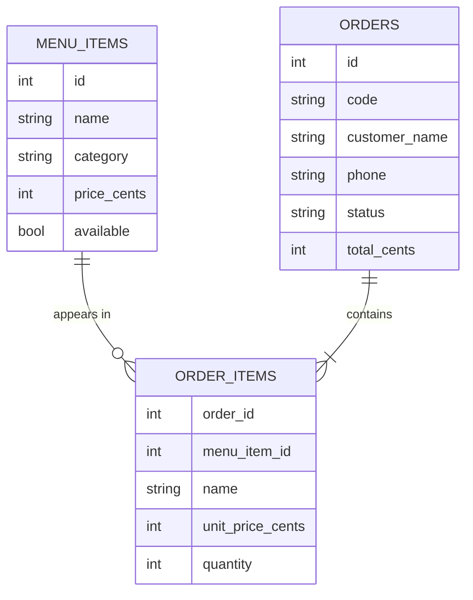

# Restaurant Ordering App

An order-ahead web app for a small restaurant. Customers browse the menu, build an order and check out for pickup. Kitchen staff work through incoming orders on a protected dashboard, and customers follow their order's status live.

Built with **Python, Flask, SQLite and Jinja templates**: server-rendered pages that work without client-side JavaScript.


## Features

- **Menu** grouped by category, with quantities and a running order count
- **Cart** stored in the session: change quantities, or set 0 to remove an item, with a 20-per-item limit
- **Checkout** with server-side validation and a clear message next to each invalid field
- **Order tracking page** with a short order code; it refreshes itself until the order is collected
- **Kitchen dashboard** behind a password, moving orders through *received → preparing → ready → collected*, or cancelling them
- CSRF protection on every form, HTTP-only and SameSite session cookies, and accessible labelled forms

## Run it locally

You need Python 3.12 or newer.

```bash
git clone https://github.com/Riya-086/restaurant-ordering-app.git
cd restaurant-ordering-app
python -m venv .venv
source .venv/bin/activate          # Windows: .venv\Scripts\activate
pip install -r requirements.txt
flask --app app run --debug
```

Open http://127.0.0.1:5000. The database is created and the menu seeded automatically on first start, in `instance/restaurant.db`.
The kitchen dashboard is at `/kitchen`, and the demo password is `kitchen-demo`.

| Environment variable | Purpose | Default |
|---|---|---|
| `KITCHEN_PASSWORD` | Password for the kitchen dashboard | `kitchen-demo` |
| `SECRET_KEY` | Signs session cookies. Set a fixed value in production. | random on each start |
| `DATABASE_PATH` | SQLite file location | `instance/restaurant.db` |

## Tests

```bash
pip install -r requirements-dev.txt
pytest        # 11 tests
```

The tests cover:
- Cart totals and quantity limits
- Validation messages
- Totals calculated on the server
- Price snapshots
- The CSRF check
- Kitchen sign-in
- Every allowed and forbidden status change

GitHub Actions runs lint, format checks and the tests on every push.

## Data model



## Design decisions

**Prices in integer cents.** Money is never stored as a float, so totals are exact.

**The server is the source of truth for prices.** The cart only stores item IDs and quantities. Totals are recalculated from the database at checkout, so an edited form can't change what an order costs.

**Order lines snapshot the name and price.** If the menu price changes tomorrow, yesterday's order still shows what the customer actually paid.

**One transaction per order.** The order and its lines are written together, or not at all.

**A guarded status workflow.** Only the next step or a cancellation is accepted. The update also checks the status it expects, so if two staff members click at the same moment, only one change wins and the other gets `409`.

## What I'd add next

- Online payment
- Opening hours and pickup time slots
- An admin page for editing the menu
- Email or SMS notifications when an order is ready
